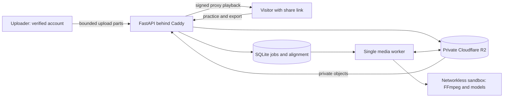

> Version 2.1 public-launch implementation: account and moderation code is available locally. This is not evidence of a completed production launch. Release gates and deviations are recorded in `deploy/PUBLIC_LAUNCH.md` and `deploy/IMPLEMENTATION_DECISIONS.md`.

# five·six — dance videos with counts and slow motion

Upload a dance video and get **1–8 counts** on it, slow-mo that keeps the pitch,
beat-by-beat stepping and repeat. Share a link or download the video with the
counts on. Self-hostable.

- Upload once; send the **Share** link. Visitors can practice and download count
  videos without a password.
- Verified email-link or Google sign-in protects each private library. Only the
  owner can rename, delete or change shared counts. Turnstile protects sign-in.
- Uploads and generated media stay available for **90 days from upload**.
- Download videos with counts at **100% or 25% speed**.
- Full-mix playback at 25%, 50%, and 75% uses prepared, pitch-preserving Rubber
  Band R3 audio. AI-separated bass, drums, piano, and guitar are under
  **More → Hear one instrument**.

[Self-hosting](SELF_HOSTING.md) · [Operations](deploy/RUNBOOK.md) ·
[Third-party software and models](THIRD_PARTY_NOTICES.md)

## Practice and sharing

The starting eight-count is inferred from the music. Counts always continue in
1–8 order through sparse passages. The attack clock moves switches near musical
attacks without inserting, deleting, or renumbering counts. Steady pulse mode is
also available. The display emphasizes 2/4/6/8, more strongly on 4 and 8.
Counts remain synchronized when changing speed, seeking, and looping.

The player keeps three things on screen: play with beat stepping, speed, and
**Repeat** (loops the current eight; widen to 16 or 32 counts from the repeat
bar). Everything else opens as a short sheet under **More**, without covering or
pausing the video: **Fix the counts** ("This is the 1", 10 ms Earlier/Later
nudges, *Follow the band* or *Even beat*), **Hear one instrument**, **Download
with counts**, and **Step by frame**. Signed-in uploaders can also rename and
delete videos there. There are no flashing instrument indicators.

The count strip marks the current count with a solid fill, the 1 with a dot, and
the accents with one colour in three weights (2/6, 4, 8). Downloads use the same
strip.

Share URLs are unlisted, random 128-bit links: **anyone with the link can view
and forward it**. There is no public video directory. Link visitors cannot change
shared count settings or delete videos. Their adjustments stay in their browser
and apply to their exports. Each account sees and manages only its own videos. A signed-in visitor to another
account's link has the same practice permissions as an anonymous visitor.

Automatic counts are estimates, especially for short clips, unclear music, and
already-slowed recordings. Instrument separation can mix rhythm guitar and
percussion. The player allows correction; it is not perfect musical
transcription. Quarter-speed audio can still have audible artifacts.

## How it works



Beat This! estimates beats and downbeats. A pretrained metrical-structure model
selects one global eight-count phase. Acoustic onset evidence and Demucs stem
estimates refine timing. Media processing runs on the host in an unprivileged
bubblewrap sandbox with no network or runtime secrets.

The default timing follows coherent detected beats as the tempo changes, fills
missing beat slots, and rejects isolated extra detections. Bar-phase consensus
and observed-slot coverage prevent a faster subdivision from winning merely by
fitting more timestamps. Alternative analysis rates use the same tolerance in
original recording seconds. The straight tempo grid remains a fallback and the
optional *Even beat* mode. Opening counts need repeated audible pulse evidence,
not perfect agreement on each attack; leading silence stays hidden. These are
consistency checks, not calibrated musical-accuracy scores.

*Follow the band* separates acoustic-event identity from waveform attack timing.
It groups candidates only when both their spectral peaks and waveform starts
fit one compact, tempo-scaled cluster. Original-mix bands establish audibility;
stems can refine the onset but are not independent confidence votes. Competing
notes remain uncertain, and a missing supplemental candidate cannot discard a
valid full-mix attack. Waveform searches clipped by their boundaries are excluded.

Onset selection happens inside the acoustic ensemble, including three waveform
rise thresholds, three FFT configurations, mix-only/joint evidence, four
continuity settings and five shifted beat priors (360 combinations). All five
prior groups must agree on the acoustic event first, then on any finer onset.
Refinement must overlap the acoustic timing range at its 12 ms resolution.
Uncertain refinement preserves a stable acoustic attack; an ambiguous acoustic
event retains the pulse. Abstaining trials cannot vote for
an unchanged timestamp. There is no post-consensus early-shift patch or fixed
offset; corrections can go either direction. These checks measure stability,
not the probability that a musical interpretation or eight-count anchor is right.

The three Python files in `research/` supply selected analysis definitions
through `choreo/research_adapter.py`; they are not standalone tools. Model
source and weights are downloaded separately and verified against the manifest.

The server enforces 500 MB / 10-minute input limits, per-account and global upload quotas,
one analysis worker, bounded export queues, and rate limits. Guest exports share
global, per-video and per-IP budgets. Identical renders are reused.

Project access ends at the 90-day deadline. The worker deletes stored media,
analysis, and exports; R2 lifecycle rules provide a backstop. Signed media URLs
last at most 15 minutes and never outlive the project. Every media request rechecks project access; removal, expiry or a hold revokes
previously issued URLs on their next request.

## Development

Use Python 3.12, Node.js, FFmpeg, Rubber Band CLI 3+, and
[uv](https://docs.astral.sh/uv/). On Ubuntu install `rubberband-cli`;
on macOS Homebrew provides `rubberband`.

```sh
uv sync --frozen --extra dev
bash scripts/check.sh
```

Tests cover access boundaries, guest exports, count settings, alignment revisions,
upload validation, quotas, expiry, retention migration, playback clocks, and real
FFmpeg / Rubber Band processing, tempo drift, missing/extra detections, and
audible versus silent openings. A frozen detector-output fixture covers the
late-start/doubled-tempo regression without including uploaded media.
Tests need no model weights or Cloudflare
credentials. Full analysis runs on the Linux host in the setup guide.

## License

The application source is MIT-licensed. Third-party software and models retain
their own terms. The pinned hypermeter repository has no explicit top-level
license; obtain the authors' permission where needed. No upstream hypermeter
source, weights, credentials, or uploaded media are included here.
See [THIRD_PARTY_NOTICES.md](THIRD_PARTY_NOTICES.md).

### Audio timing regression checks

The ordinary app tests do not measure musical accuracy. With the Linux worker
and development dependencies installed, run the reproducible waveform checks:

```sh
python scripts/benchmark-timing.py --output /tmp/timing-development.json --check
python scripts/benchmark-timing.py --suite validation --seed 841903 --output /tmp/timing-validation.json --check
```

The generator in `tests/timing_controls.py` records note beginnings before any
analysis. These tests exercise the acoustic stage with known pulse priors and
controlled timing errors; they do not evaluate the neural beat/downbeat model. It covers 72–312 BPM, tempo drift, missing notes, silence, quiet/noisy
recordings, different attack slopes, louder swung pickups, instrument entrances,
and early/late model priors. The separate validation settings change tempi,
gains, envelopes and noise. Gates reject lost sounding beats, false attacks in
breaks, wrong entrances, reversed counts, accepted attacks over 50 ms from truth,
and excessive median/tail error. `--baseline-dir` can compare an older importable
`choreo` package and adds a per-case median-regression gate.

The first five seconds are included. Many general beat evaluations discard
that interval and use a 70 ms matching tolerance, which would miss the reported
entrance/attack problem ([mir_eval beat evaluation](https://mir-eval.readthedocs.io/latest/api/beat.html)).
Generated signals validate mechanisms, not real-song listening accuracy or the
choice of count 1. Real recordings still need independently reviewed anchors.

## Accounts and public-launch controls

Uploaders sign in with a single-use email link or Google. Each account has a private library; a share-link visitor can practise and export without signing in. Signing in as another account does not grant management access. Email links expire in 15 minutes and require a confirmation click; sessions expire after 30 days. There are no user passwords. The original room password is now an additional admin check.

The free allowance is 5 uploads in 24 hours, 20 in 30 days, one active upload or analysis per account, 500 MB and 10 minutes per video. Cancelled uploads count. Global admission is 150 uploads and 10 GB per day, plus queue and storage checks. Uploads start paused; administrators may test while paused but remain subject to all other limits.

Local NSFW and person screening runs before beat analysis. Rejected files never become playable. This is a classifier, not a guarantee of legality; required real-video calibration and the operator's reporting procedure are launch gates. Only derived media is served. Originals are deleted after successful analysis; other files expire 90 days after upload.

Every player has a report form. Illegal-content reports immediately hide the video. The admin interface supports review, removal, account bans, upload holds and quarantine. Quarantine is unreachable even to the admin and survives database expiry; the bucket's 90-day lifecycle remains a preservation limit. Deleting an account does not erase a preservation hold.

Monthly guard allowances are 5 million R2 operations, 1.2 TB uploaded and 5 TB served, with a persistent manual stop. Stored files are capped at 2 TB, new upload reservations stop at 90%, and media is capped at 50 GB per video per UTC day. Set provider-side budget alerts as a separate backstop. See `deploy/PUBLIC_LAUNCH.md` for release, backup, recovery, configuration and acceptance instructions.
