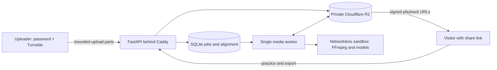

# Dance Video Practice — Counts & Slow Motion

Add automatic **1–8 counts** to dance videos. Practice with pitch-preserving slow
playback, beat stepping, and loops. Share links or export videos with counts.

- Upload once; send the **Share** link. Visitors can practice and download count
  videos without a password.
- A room password and Cloudflare Turnstile protect uploads, the video library,
  deletion, and changes to the shared count alignment.
- Uploads and generated media stay available for **90 days from upload**.
- Download videos with counts at **100% or 25% speed**.
- Full-mix playback at 25%, 50%, and 75% uses prepared, pitch-preserving Rubber
  Band R3 audio. Estimated bass, drums, piano, and guitar solos live in Tools.

[Self-hosting](SELF_HOSTING.md) · [Operations](deploy/RUNBOOK.md) ·
[Third-party software and models](THIRD_PARTY_NOTICES.md)

## Practice and sharing

The starting eight-count is inferred from the music. Counts always continue in
1–8 order through sparse passages. The attack clock moves switches near musical
attacks without inserting, deleting, or renumbering counts. Steady pulse mode is
also available. The display emphasizes 2/4/6/8, more strongly on 4 and 8.
Counts remain synchronized when changing speed, seeking, and looping.

Playback, speeds, and counts stay in view. Tools contains count correction,
frame stepping, looping, solo listening, and downloads. There are no flashing
instrument indicators.

Share URLs are unlisted, random 128-bit links: **anyone with the link can view
and forward it**. There is no public video directory. Link visitors cannot change
shared count settings or delete videos. Their adjustments stay in their browser
and apply to their exports. People signed in to the shared room can see, edit,
and delete all room videos; there are no individual user accounts.

Automatic counts are estimates, especially for short clips, unclear music, and
already-slowed recordings. Instrument separation can mix rhythm guitar and
percussion. The player allows correction; it is not perfect musical
transcription. Quarter-speed audio can still have audible artifacts.

## How it works



Beat This! estimates beats and downbeats. A pretrained metrical-structure model
selects one global eight-count phase. Acoustic onset evidence and Demucs stem
estimates refine timing. Media processing runs on the host in an unprivileged
bubblewrap sandbox with no network or runtime secrets.

The three Python files in `research/` supply selected analysis definitions
through `choreo/research_adapter.py`; they are not standalone tools. Model
source and weights are downloaded separately and verified against the manifest.

The server enforces 500 MB / 10-minute input limits, room-wide upload quotas,
one analysis worker, bounded export queues, and rate limits. Guest exports share
the room budget plus a per-IP limit. Identical renders are reused.

Project access ends at the 90-day deadline. The worker deletes stored media,
analysis, and exports; R2 lifecycle rules provide a backstop. Signed media URLs
last at most 15 minutes and never outlive the project. A previously issued URL
can remain usable until its short expiry or object deletion.

## Development

Use Python 3.12, Node.js, FFmpeg, Rubber Band CLI 3+, and
[uv](https://docs.astral.sh/uv/). On Ubuntu install `rubberband-cli`;
on macOS Homebrew provides `rubberband`.

```sh
uv sync --frozen --extra dev
bash scripts/check.sh
```

Tests cover access boundaries, guest exports, count settings, alignment revisions,
upload validation, quotas, expiry, retention migration, playback clocks, and real
FFmpeg / Rubber Band processing. Tests need no model weights or Cloudflare
credentials. Full analysis runs on the Linux host in the setup guide.

## License

The application source is MIT-licensed. Third-party software and models retain
their own terms. The pinned hypermeter repository has no explicit top-level
license; obtain the authors' permission where needed. No upstream hypermeter
source, weights, credentials, or uploaded media are included here.
See [THIRD_PARTY_NOTICES.md](THIRD_PARTY_NOTICES.md).
